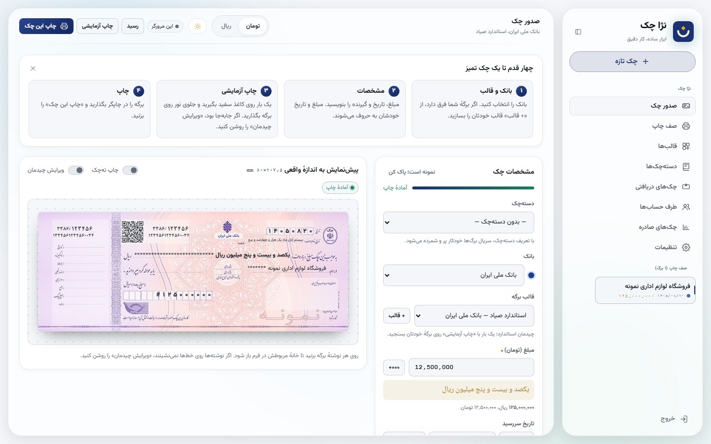

<p align="center">
  
</p>

<div dir="rtl" align="center">

# نژا چک

**نرم‌افزار چک چاپ رایگان؛ چاپ چک صیادی همهٔ بانک‌ها** — ساختهٔ [علی رسولی‌نژاد](https://www.linkedin.com/in/ali-rasoulinejad-bb400b243) · نژا

[**⬇ دانلود برای ویندوز**](https://github.com/arasouli82-dev/NejaCheque/releases/latest) · [وب‌سایت](https://arasouli82-dev.github.io/NejaCheque/)

</div>

<p align="center">
  
</p>

<div dir="rtl">

نرم‌افزار تحت وب و چندکاربره برای نوشتن چک روی برگهٔ واقعی با هر چاپگری (حتی لیزری A4)، و پیگیری چک‌های صادره و دریافتی تا وصول. روی یک رایانهٔ اداره یا یک سرور اجرا می‌شود و همه از مرورگر کار می‌کنند.

## امکانات

- **چاپ چک** با پیش‌نمایش هم‌اندازهٔ برگه؛ تاریخ و مبلغ خودکار به حروف؛ ارقام فارسی؛ `#` و ستاره در جای خالی
- **قالب ۳۰ بانک** (چیدمان یکسان صیادی) و **ساخت قالب دلخواه** از روی عکس برگه با کشیدن و رها کردن
- قلم، اندازه، چینش و جهت جداگانه برای هر نوشته؛ قلم نستعلیق؛ چاپ **نگاتیو** و **پرفراژ**
- «عدم پشت‌نویسی»، خط کشیدن روی «حواله‌کرد»، توضیحات روی برگه، ته‌چک اختیاری
- **دسته‌چک‌ها**: سریال برگ بعدی خودکار، نقشهٔ برگ‌های مصرف‌شده و باطل، هشدار اتمام دسته‌چک
- **صف چاپ**، **سری اقساطی**، **ورود از اکسل/CSV**
- **چک‌های صادره** با وضعیت (صادرشده، وصول‌شده، برگشتی، باطل)، فیلتر، گزارش چاپی و خروجی اکسل
- **چک‌های دریافتی** از مشتری‌ها، از دریافت تا خواباندن و وصول
- **طرف حساب‌ها**، **رسید پرداخت** قابل تنظیم، **تعطیلات رسمی** شمسی و قمری
- **یادآوری سررسید** در برنامه، در پیام‌رسان **بله** و با **پیامک** (کاوه‌نگار، SMS.ir)
- **کاربران** با دو نقش مدیر و کاربر، **پشتیبان‌گیری و بازگردانی**، تم روشن و تاریک

## نصب

### ویندوز (ساده‌ترین راه)

۱. از صفحهٔ [**Releases**](../../releases/latest) فایل `NejaCheque-Setup-….exe` را بگیرید.
۲. اجرایش کنید و چند بار «Next» بزنید. به پایتون یا هیچ برنامهٔ دیگری نیاز نیست.
۳. روی آیکون **«نژا چک»** روی دسکتاپ بزنید؛ مرورگر باز می‌شود و حساب مدیر را می‌سازید.

<details>
<summary>ویندوز گفت «Windows protected your PC»؟</summary>

این هشدار برای همهٔ برنامه‌هایی است که امضای دیجیتال پولی ندارند. روی **More info** و بعد **Run anyway** بزنید.
</details>

**برای همهٔ اداره:** نژا چک را روی یک رایانه نصب کنید که بیشتر وقت‌ها روشن است، و در نصب این دو گزینه را بزنید:
«Start Neja Cheque when Windows starts» و «Let other computers on the network open it».
نژا چک پنجره‌ای ندارد و آیکونش کنار ساعت ویندوز می‌نشیند. با کلیک راست روی آن، نشانی شبکه (مثل `http://192.168.1.20:8080`) را می‌بینید؛ همکاران همین نشانی را در مرورگرشان باز می‌کنند. خاموش کردن هم از همین منوست. کاربر هر کس را از «تنظیمات ← کاربران» بسازید.

داده‌ها در `C:\ProgramData\NejaCheque` است و با حذف یا به‌روزرسانی برنامه پاک نمی‌شود.
اگر نصب نمی‌خواهید، نسخهٔ `NejaCheque-Portable-….zip` را باز کنید و `NejaCheque.exe` را اجرا کنید.

### سرور لینوکس (داکر)

```bash
docker run -d --name nejacheque -p 8080:8080 -v nejacheque:/data --restart unless-stopped ghcr.io/arasouli82-dev/nejacheque:latest
```

بعد `http://<IP-سرور>:8080` را باز کنید. اگر پشت HTTPS اجرا می‌کنید، `-e NEJACHEQUE_COOKIE_SECURE=1` اضافه کنید.

### از روی کد

با پایتون ۳.۱۰ یا تازه‌تر: در ویندوز `run.bat` و در لینوکس/مک `./run.sh`. یا `docker compose up -d`.

## انتشار نسخهٔ تازه

شمارهٔ نسخه را در `nejacheque/__init__.py` بالا ببرید، بعد:
```bash
git tag v1.0.1 && git push --tags
```
گیت‌هاب خودش فایل نصب ویندوز، نسخهٔ قابل‌حمل و تصویر داکر را می‌سازد و در صفحهٔ Releases می‌گذارد (`.github/workflows/release.yml`).

## تنظیمات

همهٔ تنظیم‌ها اختیاری است؛ `.env.example` را به `.env` کپی و ویرایش کنید:

| متغیر | پیش‌فرض | کار |
|---|---|---|
| `NEJACHEQUE_DATA_DIR` | `./data` | جای پایگاه‌داده و کلید رمزگذاری |
| `NEJACHEQUE_SECRET_KEY` | ساخته می‌شود | کلید رمزگذاری توکن بله و کلید پیامک |
| `NEJACHEQUE_COOKIE_SECURE` | `0` | روی HTTPS بگذارید `1` |
| `NEJACHEQUE_SESSION_DAYS` | `14` | مدت اعتبار ورود |
| `NEJACHEQUE_REMINDERS` | `1` | حلقهٔ یادآوری روزانه |
| `PORT` | `8080` | درگاه |

همهٔ داده‌ها در پوشهٔ `data/` است؛ از آن یا از «تنظیمات ← پشتیبان‌گیری» مرتب پشتیبان بگیرید.

## نخستین چاپ

۰. چک را در **ورودی دستی** چاپگر بگذارید. برنامه صفحهٔ A4 می‌فرستد و نوشته‌ها را درست جای برگه در ورودی می‌گذارد؛ اینکه چک رو به بالا باشد یا پایین را «راهنمای گذاشتن چک» در پنجرهٔ چاپ، با یک کاغذ سفید، معلوم می‌کند.
۱. اندازهٔ برگهٔ چک را با خط‌کش (از لبه تا لبه، همراه ته‌چک) در «ویرایش چیدمان ← برگه و چاپگر» وارد کنید.
۲. یک «چاپ آزمایشی» روی کاغذ سفید بگیرید و جلوی نور روی برگه بگذارید.
۳. اگر همه‌چیز کمی جابه‌جاست، «جابه‌جایی افقی/عمودی» را تنظیم کنید؛ اگر یک نوشته جابه‌جاست، همان را بکشید.
۴. در پنجرهٔ چاپ مرورگر **Margins = None** و **Scale = 100%** بگذارید.

## برند خودتان

اگر می‌خواهید نسخهٔ خودتان را با نام و نشان دیگری منتشر کنید، همه‌چیز در `web/assets/brand/` است: `brand.js` (نام و شعار)، `logo.svg` و `favicon.svg`، و `brand.css` (رنگ‌ها). طبق مجوز، نام سازندهٔ اصلی در فایل LICENSE بماند.

## فونت‌ها بدون اینترنت

صفحه‌ها فونت وزیرمتن را از Google Fonts می‌گیرند. برای شبکهٔ بدون اینترنت، فایل‌های woff2 وزیرمتن ([مخزن رسمی](https://github.com/rastikerdar/vazirmatn)، مجوز OFL) را در `web/assets/fonts/` بگذارید و یک `@font-face` در `brand.css` اضافه کنید.

## توسعه

```bash
pip install -r requirements-dev.txt
pytest
```

- `nejacheque/app.py`: صفحه‌ها، ورود، API
- `nejacheque/service.py`: منطق چک‌ها، یادآوری، بله و پیامک
- `nejacheque/db.py`: پایگاه‌دادهٔ SQLite
- `web/index.html` و `web/assets/cheque/cheque.js`: برنامهٔ مرورگر (چیدمان، چاپ، فرم‌ها)
- `web/assets/ui/`: کیت رابط کاربری

## یادداشت‌ها

- چیدمان استاندارد از روی یک تصویر نمونهٔ چک صیادی اندازه گرفته شده و ممکن است با برگهٔ شما چند میلی‌متر فرق کند؛ همیشه یک چاپ آزمایشی بگیرید.
- تعطیلات قمری با تقویم ام‌القری حساب می‌شود و ممکن است یک روز با اعلام رسمی فرق کند؛ در تنظیمات قابل اصلاح است.
- این برنامه چک را در سامانهٔ صیاد ثبت نمی‌کند؛ پس از چاپ، ثبت را در اپ بانک انجام دهید.

## سازنده

**علی رسولی‌نژاد** (نژا)
- لینکدین: [ali-rasoulinejad-bb400b243](https://www.linkedin.com/in/ali-rasoulinejad-bb400b243)
- ایمیل: ali.rasoulinejaad@gmail.com

پیشنهاد، گزارش اشکال و همکاری با آغوش باز پذیرفته می‌شود.

## مجوز

[MIT](LICENSE) — © ۲۰۲۶ علی رسولی‌نژاد (نژا)

</div>

---

## English

**Neja Cheque** is a self-hosted web app by **Ali Rasoulinejad (Neja)** for writing, printing and tracking Iranian Sayad cheques: true-size layout editor with drag-and-drop templates for 30 banks and custom leaves, amounts and dates in Persian words, chequebook leaf tracking, issued and received cheque registers, Excel/CSV import, official holidays, receipts, Bale and SMS due-date reminders, multi-user with manager/operator roles, backup and restore.

- **Windows:** download `NejaCheque-Setup-….exe` from [Releases](../../releases/latest), install, click the «نژا چک» icon.
- **Linux server:** `docker run -d -p 8080:8080 -v nejacheque:/data ghcr.io/arasouli82-dev/nejacheque:latest`
- **From source:** `./run.sh` (or `run.bat`), then create the first (manager) account in the browser.

Settings via environment variables (see `.env.example`). Tests: `pip install -r requirements-dev.txt && pytest`. License: MIT.

Author: **Ali Rasoulinejad** · [LinkedIn](https://www.linkedin.com/in/ali-rasoulinejad-bb400b243) · ali.rasoulinejaad@gmail.com
